# Echo — Screen Flows (draft v0.2, not committed)

Companion to `docs/PRD.md` (v0.3). Navigation follows decision D22. Diagrams are Mermaid; they render on GitHub and in most Markdown viewers.

**Legend:** rectangles = screens · diamonds = decisions · rounded = system actions · 🔒 = private-profile data involved · 🛟 = crisis entry available

**Global rules that apply to every flow**
- 🛟 "Need urgent help?" is reachable in ≤ 2 taps from every screen and is never paywalled.
- Members are shown only as **pen name + avatar**. Private-profile data (name, ID, age, phone) never appears on a member-facing screen.
- In chat and forum, messages containing links, phone numbers, addresses or videos are blocked before delivery with a friendly explanation.
- Block and Report are available on every message, post, comment and member card.

---

## 1. Navigation map (member app)

Bottom tabs: **Home · Chats · Forum · Therapists · Help**. **Me** (profiles, plans, settings, account standing) opens from the member's **avatar at the top-left** of every screen, and **urgent help** from the top bar of every screen (D22).

**1a. Tabs**

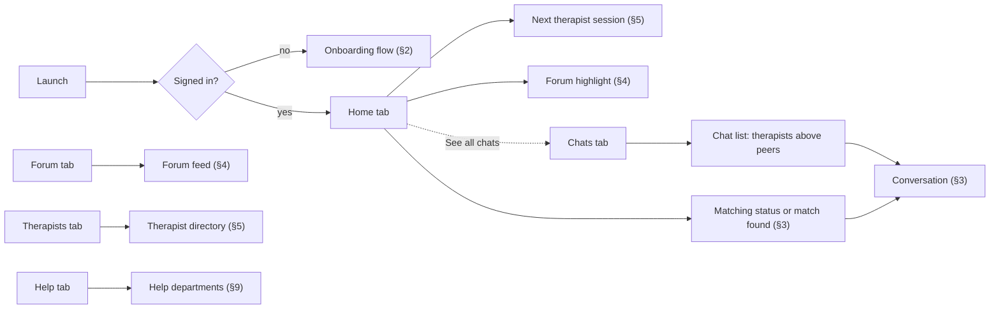

**1b. Reachable from every screen**

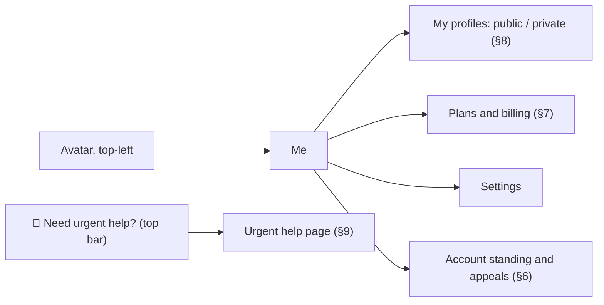

---

## 2. Onboarding and sign-up

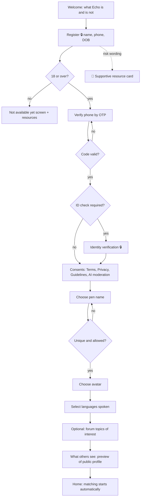

Screens: Welcome · Register · Under-18 notice · OTP · ID verification · Consents · Pen name · Avatar · Languages · Topics · Public-profile preview.

---

## 3. Automatic matching and peer chat

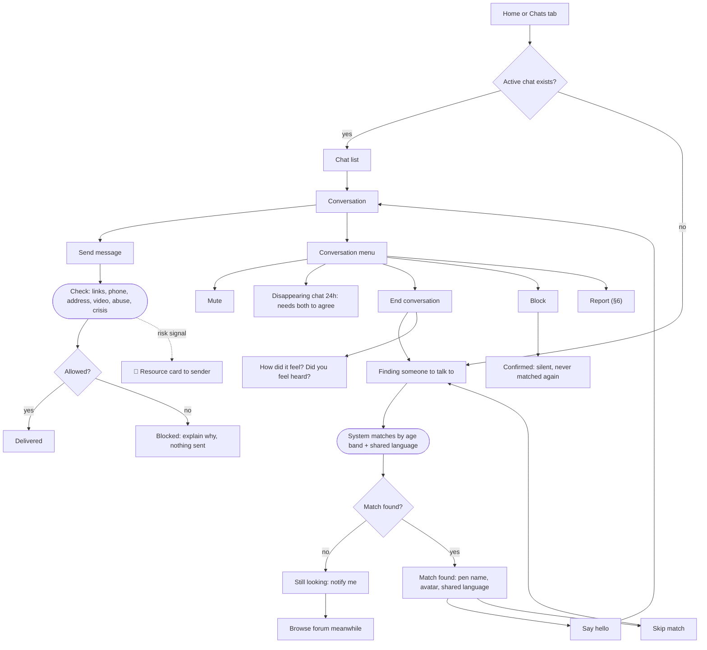

Screens: Matching status · Match found · Chat list · Conversation · Blocked-message notice · Conversation menu · Disappearing-chat consent · Rating prompt.

---

## 4. Public forum

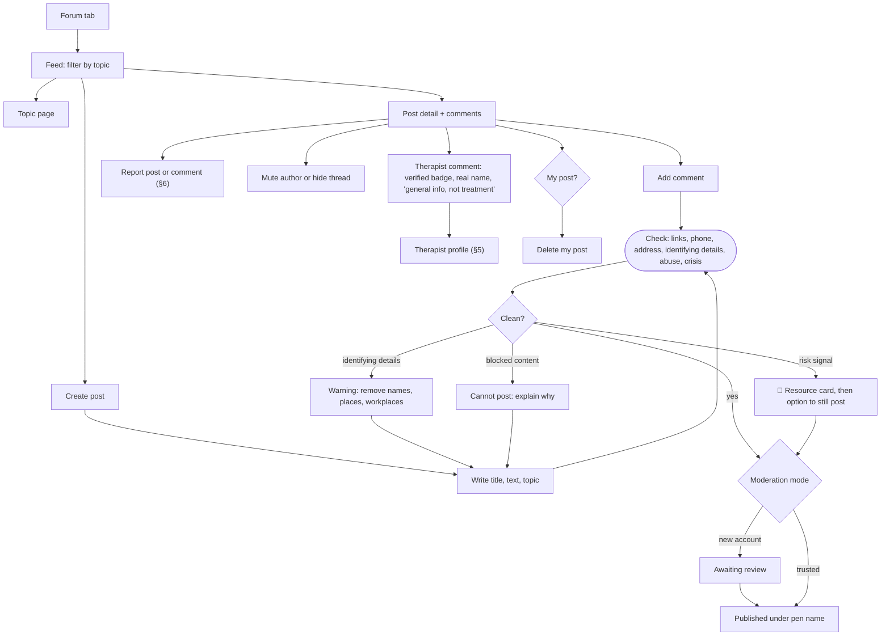

Screens: Feed · Topic · Post detail · Create post · Identifying-details warning · Pending review notice · Comment composer · Report sheet.

---

## 5. Therapists: directory, booking, chat, voice, video

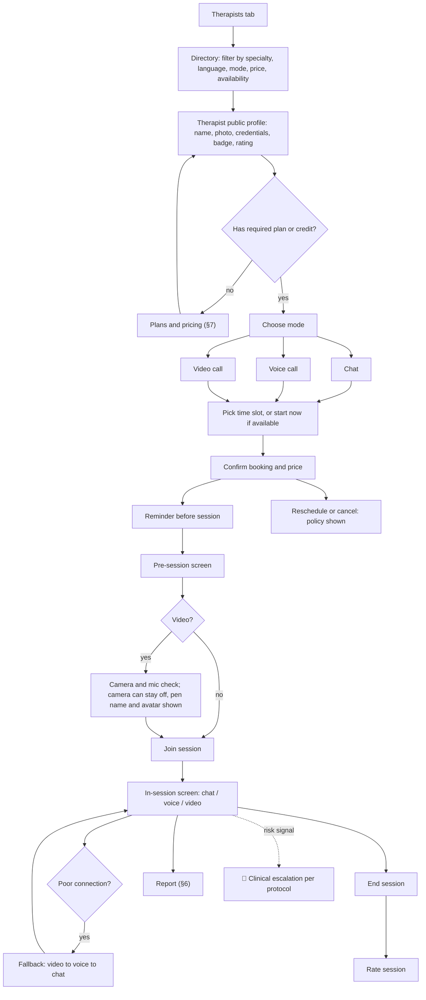

Therapist-side screens (portal): Application and credential upload · Verification status · Profile (public) · Availability calendar · Client inbox · Session screen (chat/voice/video) · Private session notes · Earnings and payouts.

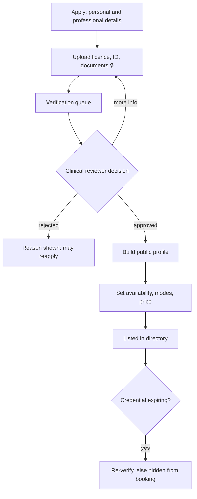

---

## 6. Report, block, strikes, appeals

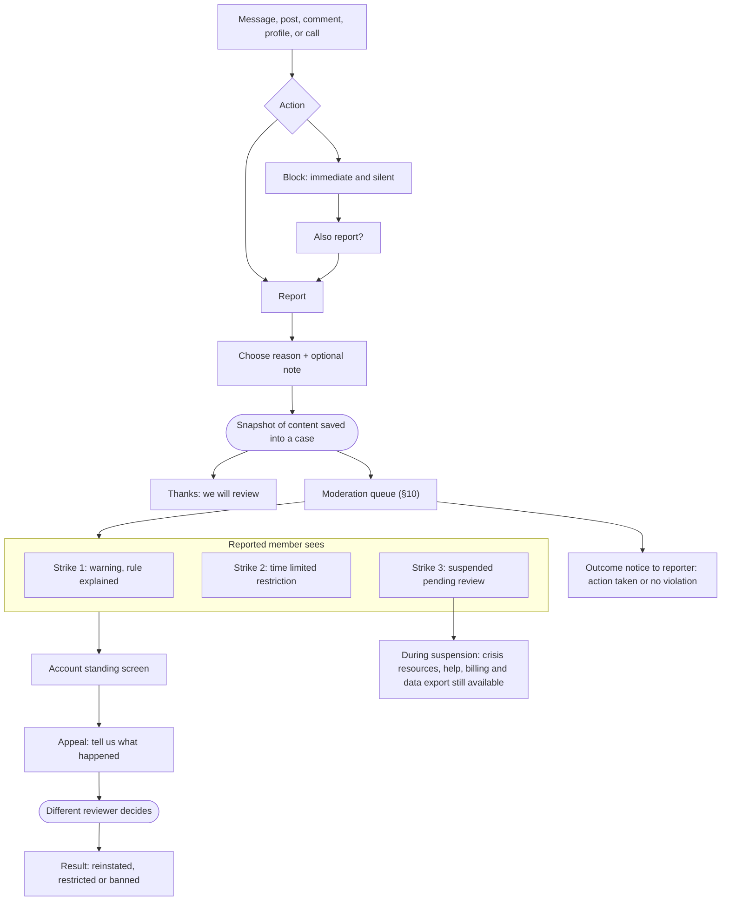

---

## 7. Plans and billing

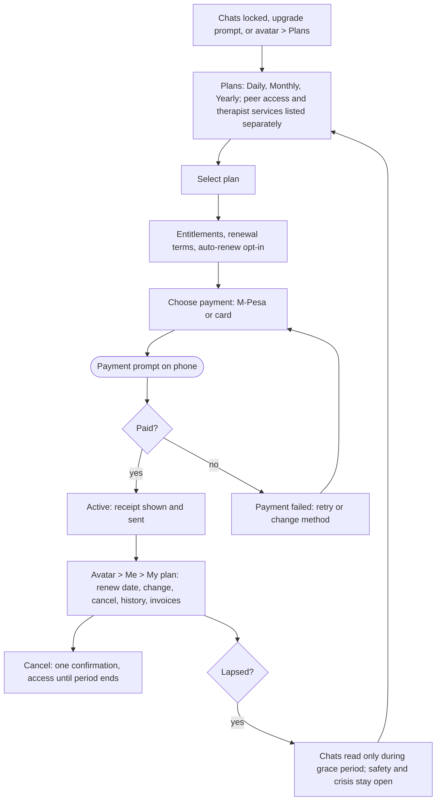

---

## 8. Profiles: public vs private

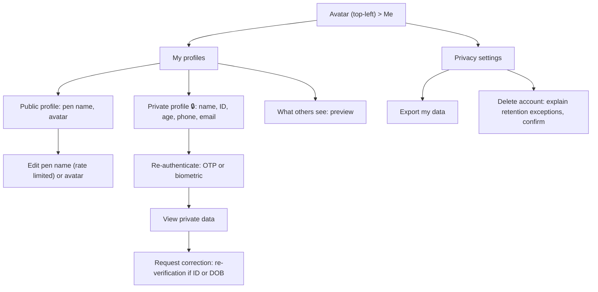

---

## 9. Help centre by department

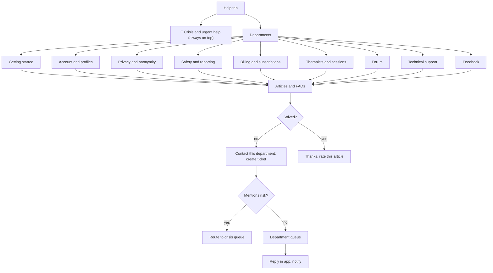

---

## 10. Admin web: key flows

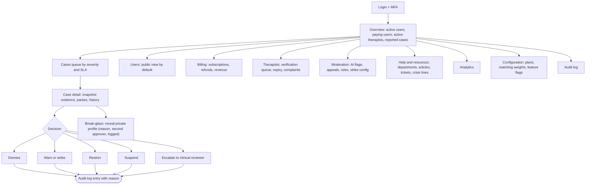

---

## Screen count

| Surface | Screens (approx.) |
|---|---|
| Member app | ~45 |
| Therapist portal | ~10 |
| Admin web | ~18 |

## Open flow questions (feed back into PRD §14)

1. **After a skip or ended chat, how quickly does the next match appear?** Immediately risks "shopping"; a short cooldown or daily cap may be better.
2. **Does a member with no plan see the forum?** Draft assumes the forum is readable and postable on free accounts. Confirm.
3. **On-demand vs scheduled therapist sessions** (D4) changes the booking flow in §5.
4. **Camera-off with therapists** (D15) changes the pre-session screen.
5. **What counts as a "help department" (assumption in HLP-1)?** The list in §9 follows the support areas of the app. If you meant a directory of outside organisations (hotlines, clinics), that should be a separate section.
6. **Is free-text allowed anywhere on the public profile?** Draft: no bio.

## Next step suggestions

Wireframes for the five highest-risk screens: Welcome/consents, Match found + chat, Create post (with the identifying-details warning), Therapist profile + booking, and Report sheet.
